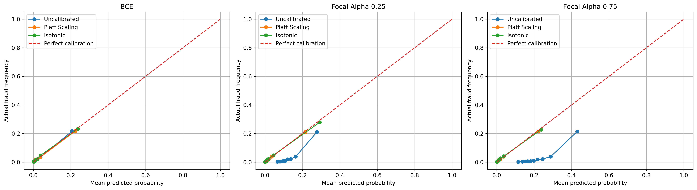
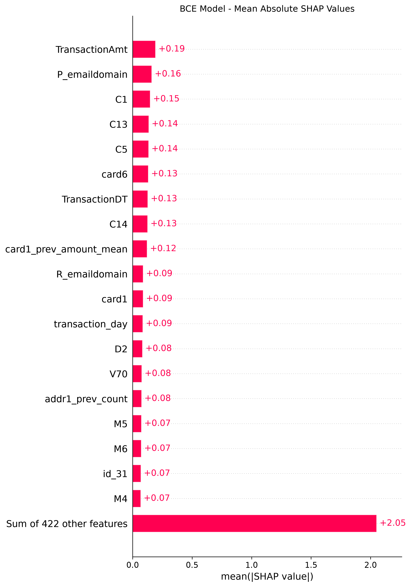
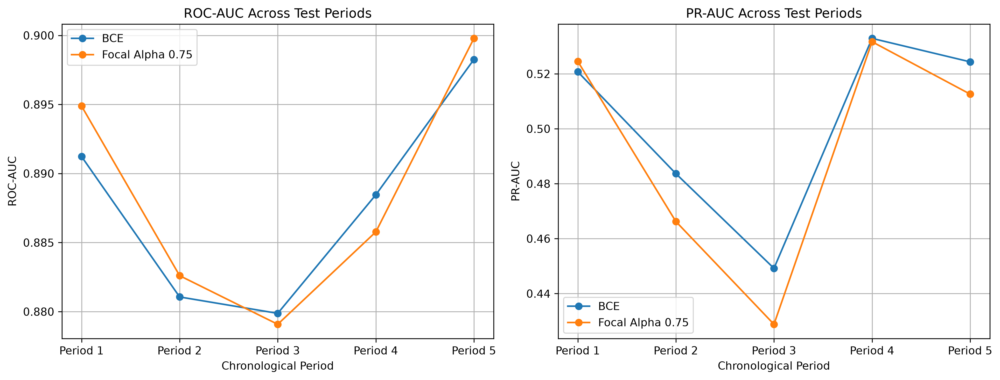
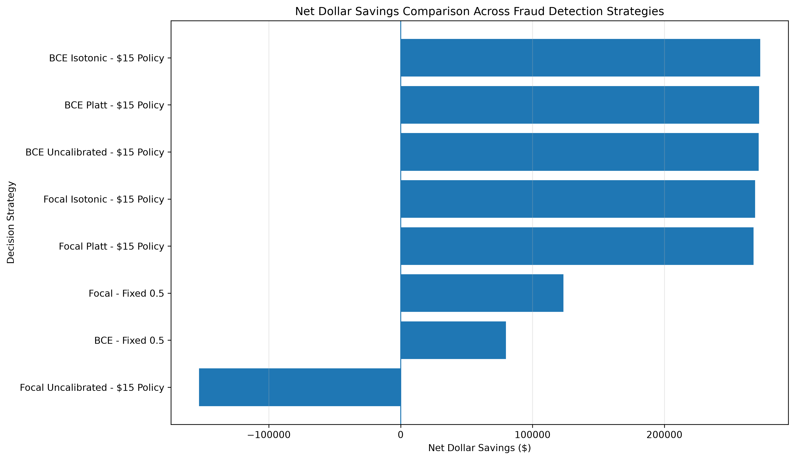

# Fraud Detection System
### Advanced Fraud Detection Using Concept Drift Analysis and Probability Calibration

A machine learning project focused on detecting fraudulent financial transactions using LightGBM, Focal Loss, Concept Drift Analysis, Probability Calibration, and Explainable AI.

---

1. Project Overview

Fraud detection is a challenging machine learning problem due to highly imbalanced datasets, evolving fraud patterns, and unreliable probability predictions.

This project develops a fraud detection pipeline using the **IEEE-CIS Fraud Detection Dataset**.

The system focuses on identifying fraudulent transactions, analyzing changes in transaction patterns over time, improving probability calibration, and evaluating the financial impact of model predictions.

 Project Objectives

- Develop an effective machine learning fraud detection model.
- Handle highly imbalanced transaction data.
- Analyze concept drift and changing fraud patterns.
- Implement and compare Binary Cross-Entropy and Focal Loss.
- Improve probability reliability through calibration.
- Explain model predictions using SHAP.
- Evaluate business impact using Net Dollar Savings.

---

2. Technology Stack

| Category | Technologies |

| Programming Language | Python |
| Data Processing | Pandas, NumPy |
| Machine Learning | LightGBM, Scikit-learn |
| Imbalanced Learning | Focal Loss |
| Probability Calibration | Platt Scaling, Isotonic Regression |
| Explainable AI | SHAP |
| Data Visualization | Matplotlib |
| Development Environment | Jupyter Notebook |
| Version Control | Git, GitHub |

---

3. Project Workflow

 Phase 1: Data Loading and Exploratory Data Analysis

- Loaded and merged transaction and identity datasets.
- Analyzed missing values and feature distributions.
- Examined fraud distribution and class imbalance.
- Created chronological training, validation, and testing splits.

 Phase 2: Baseline Model Development

- Developed a baseline LightGBM classifier.
- Evaluated model performance using ROC-AUC, PR-AUC, Precision, Recall, and F1-score.
- Used chronological validation to assess future transaction performance.

 Phase 3: Concept Drift Analysis

- Implemented adversarial validation.
- Analyzed feature distribution changes using Population Stability Index (PSI).
- Examined conditional fraud rates and feature interactions.
- Investigated changes in fraud patterns over time.

 Phase 4: Advanced Model Development

- Implemented a custom Focal Loss objective.
- Compared Binary Cross-Entropy and Focal Loss models.
- Evaluated different Focal Loss configurations.
- Conducted feature ablation experiments.

 Phase 5: Probability Calibration

Implemented two calibration techniques:

**Platt Scaling**
- Uses logistic regression to calibrate predicted probabilities.

**Isotonic Regression**
- Uses a non-parametric approach to improve probability calibration.

Evaluated calibration using reliability diagrams and calibration metrics.

 Phase 6: Explainable AI Using SHAP

- Analyzed feature importance.
- Investigated individual prediction contributions.
- Compared BCE and Focal Loss feature explanations.
- Identified influential features in fraud predictions.

 Phase 7: Cost-Sensitive Evaluation

- Analyzed false positives and false negatives.
- Investigated high-cost missed fraud cases.
- Compared decision thresholds.
- Evaluated financial impact using Net Dollar Savings.

---

4. Model Performance

 Baseline LightGBM Results

| Evaluation Metric | Validation Score |

| ROC-AUC | 0.91678 |
| PR-AUC | 0.58386 |
| Precision | 0.8462 |
| Recall | 0.3491 |
| F1-Score | 0.4943 |

 Calibration and Threshold Evaluation

Selected thresholds from the calibration evaluation:

| Metric | BCE | Focal Loss (α = 0.75) |

| Threshold | 0.16 | 0.33 |
| Precision | 0.4179 | 0.5973 |
| Recall | 0.4603 | 0.3326 |
| F1-Score | 0.4381 | 0.4273 |
| False Positives | 929 | 325 |
| False Negatives | 782 | 967 |

These results demonstrate the trade-off between detecting more fraudulent transactions and reducing false alarms.

*Note: These are calibration threshold-selection evaluation results, not independent final test results.*

---

 5. Visualizations and Results

 Model Comparison

The project includes comparisons of model performance using ROC-AUC and PR-AUC.

 Probability Calibration

Reliability diagrams are used to compare predicted probabilities with observed fraud frequencies.

 Concept Drift Analysis

PSI and temporal analysis help identify changes in transaction patterns.

 SHAP Explainability

SHAP visualizations explain the contribution of individual features to model predictions.

 Net Dollar Savings

Net Dollar Savings analysis evaluates the financial value of fraud detection decisions by considering the costs and benefits of model predictions.

 Important Result Visualizations

**Calibration Comparison**



**SHAP Feature Importance**



**Temporal Model Performance**



**Net Dollar Savings**



---

 6. Repository Structure

```text
Fraud-Detection-System/
│
├── notebooks/
│   ├── 01_Data_Loading_and_EDA.ipynb
│   ├── 02_Advanced_Implementation.ipynb
│   ├── 03_Model_Calibration_Evaluation_Explainability.ipynb
│   └── 04_Net_Dollar_Savings.ipynb
│
├── models/
│   ├── bce_model.pkl
│   ├── focal_alpha75_model.pkl
│   ├── lightgbm_baseline.pkl
│   ├── isotonic_regression.pkl
│   └── platt_scaling.pkl
│
├── results/
│   ├── Evaluation Metrics (.csv)
│   ├── Visualizations (.png)
│   └── Analysis Reports (.md)
│
├── .gitignore
└── README.md
```

---

 7. Dataset Information

**Dataset:** IEEE-CIS Fraud Detection

**Source:** Kaggle

https://www.kaggle.com/competitions/ieee-fraud-detection

The original dataset files are not included in this repository.

Download the dataset from Kaggle and place the required files in the appropriate local data directory before executing the notebooks.

---

 8. Installation and Execution

 Step 1: Clone the Repository

```bash
git clone https://github.com/naghulpranav001/Fraud-Detection-System.git

cd Fraud-Detection-System
```

 Step 2: Create a Virtual Environment

```bash
python -m venv .venv
```

Activate on Windows:

```powershell
.venv\Scripts\activate
```

 Step 3: Install Dependencies

```bash
pip install pandas numpy scikit-learn lightgbm shap matplotlib seaborn jupyter pyarrow
```

 Step 4: Download the Dataset

Download the IEEE-CIS dataset from Kaggle and configure the local dataset paths required by the notebooks.

 Step 5: Run Jupyter Notebook

```bash
jupyter notebook
```

Execute the notebooks in this order:

1. `01_Data_Loading_and_EDA.ipynb`
2. `02_Advanced_Implementation.ipynb`
3. `03_Model_Calibration_Evaluation_Explainability.ipynb`
4. `04_Net_Dollar_Savings.ipynb`

---

 9. Key Learnings

- Handling highly imbalanced classification problems.
- Developing LightGBM-based fraud detection models.
- Understanding concept drift and adversarial validation.
- Implementing custom Focal Loss.
- Probability calibration and threshold optimization.
- Explainable machine learning using SHAP.
- Cost-sensitive model evaluation.
- Evaluating financial impact through Net Dollar Savings.

---

 10. Future Improvements

- Automated concept drift monitoring.
- Adaptive model retraining.
- Real-time fraud prediction API.
- Interactive fraud monitoring dashboard.
- Automated model performance tracking.

---

## Author

**Naghul Pranav**

Computer Science Engineering

GitHub: [@naghulpranav001](https://github.com/naghulpranav001)

Project Repository: [Fraud Detection System](https://github.com/naghulpranav001/Fraud-Detection-System)

---

If you find this project interesting, feel free to explore the implementation notebooks and results.

⭐ Star this repository if you find it useful!